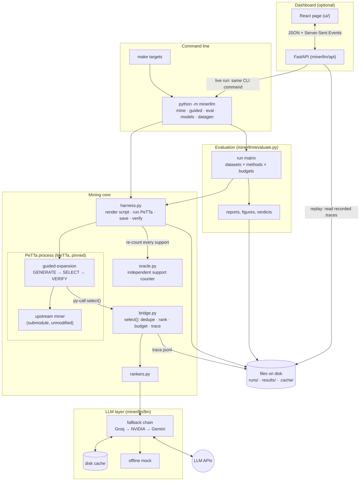
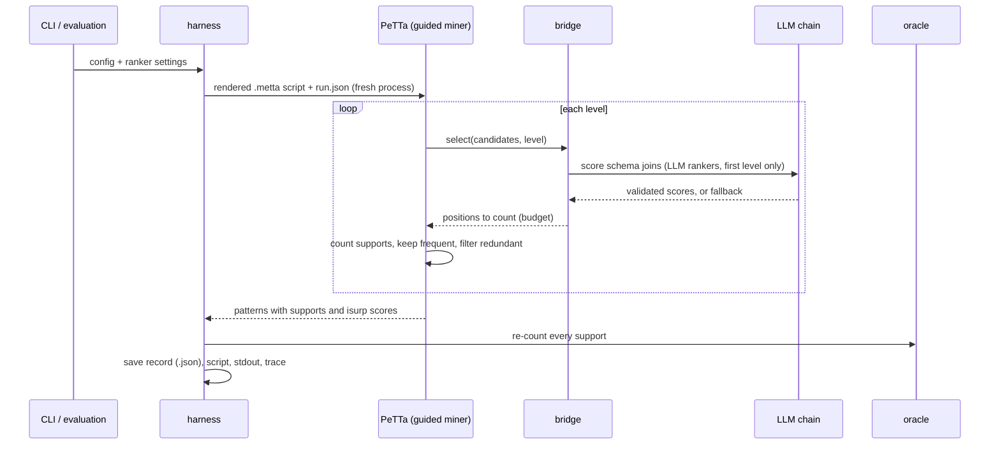
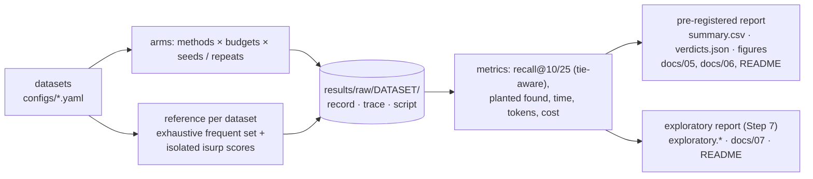
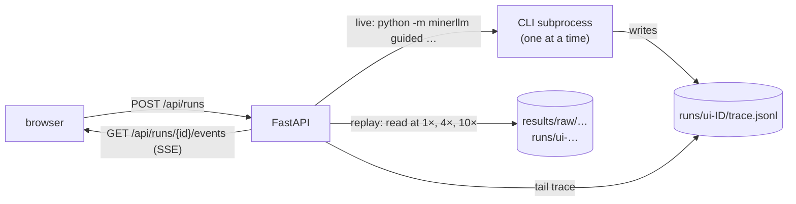

# Architecture

How the whole system fits together: the miner, the LLM layer, the evaluation and the
dashboard. For the mining pipeline in depth (sequence diagram, interfaces, validator rules,
failure path) see [Step 3: Architecture](docs/03-architecture.md). Design decisions are
recorded as [ADRs](docs/adr/).

## The idea in one paragraph

The Hyperon Pattern Miner grows patterns by joining frequent ones into larger conjunctions.
At 3 conjuncts the number of candidates to count explodes ([Issue 6](docs/01-problem.md)).
This project splits that step into **generate → select → verify**. A *ranker* chooses which
candidates the miner counts first, and only a budget (for example 30 %) is counted. An LLM can
be one of those rankers, but it **only orders candidates**. Every pattern in the output is
counted by the miner and re-counted by an independent Python oracle, so the output stays
symbolically verifiable whatever the LLM says ([ADR 0003](docs/adr/0003-llm-orders-never-decides.md)).

## System overview

## Layers

| Layer | Where | Responsibility | Knows about |
|---|---|---|---|
| Upstream miner | `external/hyperon-miner` (git submodule, pinned, unmodified) | candidate clauses, support counting, redundancy filter, `isurp`/`jsd` scoring | MeTTa only |
| Guided expansion | `experiments/llm-guided-miner/guided-conjunction-expansion.metta` | runs each level as generate → select → verify, reusing upstream functions | the bridge's `select()` |
| Bridge | `minerllm/bridge.py` | the single MeTTa ↔ Python boundary: deduplicate, rank, apply the budget, write the trace | rankers |
| Rankers | `minerllm/rankers.py` | turn candidates into an **order**; validate LLM answers | schema statistics, the LLM chain |
| LLM layer | `minerllm/llm/` | providers over plain HTTPS, retries, fallback, cache, mock | prompts and text only, nothing about patterns |
| Harness and oracle | `minerllm/harness.py`, `minerllm/oracle.py` | run a config in a fresh PeTTa process, re-check every support, save artefacts | MeTTa scripts, datasets |
| Evaluation | `minerllm/evaluate.py`, `minerllm/reference.py` | run every method on every dataset; metrics, verdicts, figures, report | harness, result files |
| Dashboard | `minerllm/api/`, `ui/` | show runs live or replayed: progress, LLM usage, patterns, comparison | the CLI and result files |

Each layer depends only on the ones below it. The LLM layer never sees data atoms or
patterns' meaning, and the dashboard adds no mining logic of its own
([ADR 0009](docs/adr/0009-dashboard-over-the-cli.md)).

## Rankers

All rankers return a permutation of the unique candidates. The bridge counts the first
⌈budget × candidates⌉ of them.

| Strategy | Order | LLM calls per dataset | Status |
|---|---|---:|---|
| `exhaustive` | all candidates | 0 | reference (budget 100 %) |
| `random` | seeded shuffle | 0 | baseline |
| `heuristic` | structural prior (multi-relation joins first) | 0 | baseline |
| `cardinality` | independence estimate of support, likely-frequent first ([ADR 0008](docs/adr/0008-cardinality-baseline.md)) | 0 | baseline, and the fallback for every LLM ranker |
| `llm` | LLM scores each schema join once; candidates by mean join score ([ADR 0004](docs/adr/0004-join-level-scoring.md)) | ≈ 3 | pre-registered (H1, H2) |
| `llm-direct` | LLM scores every candidate | ≈ 150 | cost comparison |
| `llm-hybrid` | cardinality order interleaved with the LLM join order, 3 ratings averaged ([ADR 0010](docs/adr/0010-merge-llm-and-cardinality.md)) | ≈ 9 | exploratory (Step 7) |

## Runtime views

### One guided run

Details, interfaces and the full failure path: [Step 3](docs/03-architecture.md).

### Evaluation

* Every arm is resumable: a finished record is skipped on the next run.
* A run where no LLM batch was answered is treated as invalid: it stops the evaluation,
  is re-run on resume and never enters a metric ([docs/07 run log](docs/07-exploratory.md)).
* Pre-registered and exploratory results are computed by the same code but reported
  separately, so Step 7 can never change the Step 6 verdicts.

### Dashboard

* **Live** runs execute the exact CLI command (shown on the page) and stream the trace the
  bridge already writes. They are saved under `runs/ui-<id>/` and stay replayable after a
  restart.
* **Replays** stream a recorded trace, then load that run's result. No keys, no network.
* Usage (requests, tokens, cache hits, retries, rate-limit waits, cost) is computed from
  trace events by pure functions (`minerllm/api/usage.py`).

## Guarantees and where they are enforced

| Guarantee | Enforced by | Checked by |
|---|---|---|
| The LLM cannot add, remove or change a pattern | bridge returns positions only; validator drops unknown ids | `tests/test_rankers.py`, `tests/test_bridge.py` |
| Output ⊆ exhaustive output, identical supports (precision 100 %) | verification is always symbolic | `test_budgeted_output_is_a_sound_subset`, every evaluation record |
| Budget 100 % + exhaustive = upstream output | guided expansion reuses upstream functions | `test-guided-equivalence.metta` |
| Every printed support is correct | oracle re-counts in every harness run | `verification` field of every record |
| Mining never stops because of the LLM | fallback chain, then cardinality order | `test_total_llm_outage_still_completes`, `make demo` step 4 |
| The LLM never sees data atoms | prompts built from schema statistics only | `test_join_prompt_has_no_data_atoms` |
| API keys never leave the machine except to their provider | keys read from `.env`; the API reports presence only | `test_provider_status_never_returns_key_values` |

## Files on disk

| Path | Contents | In git |
|---|---|---|
| `experiments/data/` | evaluation datasets and planted-pattern answer keys; `heldout/` for Step 7 | yes |
| `configs/` | one YAML miner configuration per dataset | yes |
| `results/raw/<dataset>/` | per-arm record (`.json`), ranker settings (`.run.json`), execution trace (`.trace.jsonl`); reference | yes |
| `results/` | `summary.csv`, `verdicts.json`, `results.md`, figures; `exploratory.*` | yes |
| `runs/` | ad-hoc and dashboard runs | no |
| `.cache/llm/` | LLM answers keyed by prompt and provider order | no |
| `.env` | API keys | no |

## Extending it

| To add | Change | Then |
|---|---|---|
| a ranker | a `Ranker` subclass in `rankers.py`, a branch in `make_ranker`, the name in `RankerConfig` and the CLI choices | it runs through the same bridge, budget, trace and verification |
| an LLM provider | a client in `llm/providers.py` and a branch in `build_chain` | it joins the fallback chain, cache and validator unchanged |
| a dataset | a `.metta` file (and optional `.truth.json`) plus a YAML config; register it in `evaluate.DATASETS` or `HELDOUT` | `make eval-*` builds its reference and runs every arm |

## Quality and automation

* **Tests:** 141 Python tests (no PeTTa needed, mock LLM), MeTTa tests under
  `experiments/*/tests/`, and integration tests that drive PeTTa from Python (`make test-all`).
* **CI** (`.github/workflows/ci.yml`): Python tests, MeTTa tests on the pinned PeTTa, and the
  dashboard build.
* **One command per task:** `make setup`, `doctor`, `test-all`, `reproduce-issues`, `profile`,
  `eval-baselines`, `eval-llm`, `eval-explore`, `report`, `demo`, `ui`.
* **Reproducibility:** PeTTa is pinned ([ADR 0001](docs/adr/0001-pin-petta.md)), datasets are
  generated deterministically, and every run saves its exact script, settings and trace.
* **Upstream fixes** ready to send: [`patches/`](patches/).

## Further reading

| Topic | Document |
|---|---|
| Problems found in the upstream miner | [docs/01-problem.md](docs/01-problem.md) |
| Hypothesis and success criteria | [docs/02-hypothesis.md](docs/02-hypothesis.md) |
| Mining architecture in depth | [docs/03-architecture.md](docs/03-architecture.md) |
| Prototype | [docs/04-prototype.md](docs/04-prototype.md) |
| Baseline | [docs/05-baseline.md](docs/05-baseline.md) |
| Results and verdicts | [docs/06-results.md](docs/06-results.md) |
| Exploratory follow-up | [docs/07-exploratory.md](docs/07-exploratory.md) |
| Design decisions | [docs/adr/](docs/adr/) |
