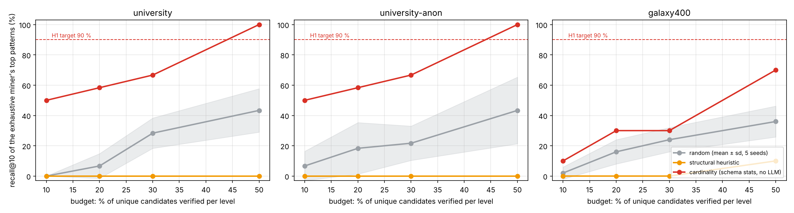

# hyperon-miner-llm

**LLM-guided candidate ranking for the [Hyperon Pattern Miner](https://github.com/iCog-Labs-Dev/hyperon-miner) (PeTTa edition), with verifiable symbolic behaviour.**

> **The LLM decides which candidate patterns to check first.
> The miner still checks everything it keeps.**

[](https://github.com/yeezyyoba/hyperon-miner-llm/actions/workflows/ci.yml)

This project answers the assignment question:

> *How can a large language model be integrated with Hyperon Miner to improve one clearly
> defined aspect of usability, correctness or performance while preserving verifiable
> symbolic behavior?*

**Aspect: performance.** Specifically conjunction expansion, where the number of candidate
patterns explodes with each extra conjunct, which kept the PeTTa miner at 3 conjuncts.

## How it works

```
             upstream miner (unmodified, MeTTa)          our module (MeTTa)            Python
 frequent clauses ──► GENERATE linked candidates ──► SELECT ──py-call──► dedupe → rank → top budget %
                       (no support counted)            │                     │
                                                       │            LLM scores schema JOINS
                                                       ▼            (Groq → NVIDIA → Gemini,
                                     VERIFY: MeTTa counts support,    validated, cached;
                                     minsup + redundancy filter        cardinality on failure)
                                                       │
                                     score with upstream isurp ──► output ──► oracle re-counts every support
```

* The LLM scores **joins between relation arguments** ("is the student's advisor a member of
  the student's department?") in about **3 calls per dataset**, reused at every level.
* It only changes **which candidates are verified first**. It can't add a pattern, change a
  support, see the data, or stop the run.
* At any budget the output is a **subset** of the full miner's output (precision 100 %). At
  budget 100 % it **equals** the upstream output (tested on 4 configurations).
* An independent Python **oracle** re-counts every support in every run.

## Results

**Verdict: the evidence does not support the hypothesis.** At a 30 % budget the LLM rankers
were less accurate on average than a deterministic schema-statistics baseline (cardinality),
and unstable across samples. In all 135 runs, the architecture's guarantee held: **100 %
precision, every support verified**, even under the worst LLM rankings. The LLM-free
pipeline finds the same frequent patterns **3× faster** than upstream and scores all of them
(641 vs 343). Details, traces, cost and failures: [docs/06-results.md](docs/06-results.md).

<!-- BEGIN HEADLINE -->
Recall@10 of the full miner's top patterns when only **30 %** of candidates are verified (planted patterns found in brackets, synthetic graphs only; ± = sd over random seeds / repeated LLM samples):

| method | university | university-anon | galaxy400 |
|---|---:|---:|---:|
| random (5 seeds) | 28 % ± 10 (1.2/3) | 22 % ± 11 (0.4/3) | 24 % ± 8 |
| structural heuristic | 0 % (0/3) | 0 % (0/3) | 0 % |
| cardinality (schema stats) | 67 % (0/3) | 67 % (0/3) | 30 % |
| LLM joins · groq | 33 % ± 26 (0.2/3) | 31 % ± 32 (1.5/3) | 22 % ± 23 |
| LLM joins · nvidia | 48 % ± 4 (0.0/3) | 8 % ± 0 (0.0/3) | 42 % ± 43 |
<!-- END HEADLINE -->



Full tables, verdicts against the pre-registered criteria, cost and failures:
[docs/06-results.md](docs/06-results.md).

### Follow-up (Step 7, exploratory)

The traces showed *why* the LLM lost: it and cardinality find different frequent patterns.
Cardinality finds the high-support structural ones, and the LLM sometimes finds the planted
ones cardinality ranks last. A follow-up ranker, **`llm-hybrid`**, merges the two orders
(half the budget each) and averages 3 LLM ratings per join. It was designed after Step 6,
so it was fixed in a committed protocol and then tested only on **held-out data**:

<!-- BEGIN EXPLORE-HEADLINE -->
Recall@10 at **30 %** budget on **held-out** datasets that played no part in the design (one run per arm; planted patterns in brackets):

| method | university-s1 | university-s2 | galaxy400-s11 |
|---|---:|---:|---:|
| cardinality (best baseline) | 73 % (0/3) | 73 % (0/3) | 20 % |
| LLM joins · groq | 9 % (1/3) | 55 % (1/3) | 50 % |
| LLM joins · nvidia | 45 % (0/3) | 45 % (0/3) | 0 % |
| **LLM + cardinality · groq** | **82 % (1/3)** | **82 % (1/3)** | **70 %** |
| LLM + cardinality · nvidia | 73 % (0/3) | 73 % (0/3) | 30 % |
<!-- END EXPLORE-HEADLINE -->

With Groq, the hybrid beat every baseline on all three held-out sets but stayed below the
90 % bar, so **H1 remains rejected**. NVIDIA's hybrid only tied cardinality on the university
graphs. One run per arm. Protocol, run log and caveats: [docs/07-exploratory.md](docs/07-exploratory.md).

## The steps

Six required steps, plus an exploratory follow-up:

| Step | Document | In one line |
|---|---|---|
| 1. Problem | [docs/01-problem.md](docs/01-problem.md) | 7 measured issues; #6, the conjunction-expansion blow-up, is the target |
| 2. Hypothesis | [docs/02-hypothesis.md](docs/02-hypothesis.md) | ≥ 90 % recall@10 at 30 % budget, better than every cheap baseline (H1); gain vanishes when names are anonymised (H2) |
| 3. Architecture | [docs/03-architecture.md](docs/03-architecture.md) · [ADRs](docs/adr/) | generate → select → verify; LLM boundary, validator and failure path; 8 decision records |
| 4. Prototype | [docs/04-prototype.md](docs/04-prototype.md) | MeTTa module + Python bridge; `make demo` |
| 5. Baseline | [docs/05-baseline.md](docs/05-baseline.md) | upstream, exhaustive, random ×5, structural heuristic, cardinality; same data and config |
| 6. Results | [docs/06-results.md](docs/06-results.md) | generated tables, figures, verdicts, cost, failures, limitations |
| 7. Follow-up (exploratory) | [docs/07-exploratory.md](docs/07-exploratory.md) | `llm-hybrid`: LLM + cardinality merged, tested on held-out data only |

Presentation guide: [docs/presentation.md](docs/presentation.md).

### Issues found in upstream (petta-main @ `7461878`)

| # | Issue | Evidence | Status |
|---|---|---|---|
| 1 | Documented entry point does not run | `(partial pattern-miner …)`: 8 args to a 9-arg function | fixed + [patch](patches/) |
| 2 | CI tracks PeTTa HEAD | **8/8** tests pass pinned, **3/8** on HEAD | fixed (pinned) + patch |
| 3 | End-to-end tests never run their assertions | corrupting an expected value still passes CI | strict runner + live tests |
| 4 | Output full of clause-order duplicates | 801 printed vs 137 distinct (83 %) at 4 conjuncts | deduplicated before counting |
| 5 | Global spaces leak state between runs | 2nd run returns 32 patterns instead of 20 | one process per run |
| 7 | Scoring silently drops about half the patterns | 641 frequent in, 343 scored out (`add-atom-nodup` unifies) | fixed in our miner + [patch](patches/) |
| **6** | **Conjunction expansion explodes** | 2→3 conjuncts: **3×** time at 200 atoms, **10×** at 800; 4 conjuncts on 200 atoms: **90 s** | **target of the LLM** |

## Quick start

Requirements: SWI-Prolog ≥ 9.1.22 **with janus** (the Python bridge), Python ≥ 3.9, git.
The venv's Python must have the **same minor version** as janus's Python (`make doctor`
checks this).

```bash
git clone --recurse-submodules https://github.com/yeezyyoba/hyperon-miner-llm.git
cd hyperon-miner-llm
python3 -m venv .venv && source .venv/bin/activate
./setup.sh                 # pinned PeTTa + Python deps
make doctor                # toolchain check

make test-all              # Python + MeTTa + integration tests
make demo                  # 5-minute live demo
```

Real LLMs: `cp .env.example .env` and add `GROQ_API_KEY`, `NVIDIA_API_KEY` and/or
`GEMINI_API_KEY` (missing providers are skipped). Then:

```bash
python -m minerllm guided --strategy llm --budget 0.3       # one run, live progress
python -m minerllm models --providers nvidia --probe        # which models really answer
make eval-baselines && make eval-llm && make report          # the whole evaluation
```

Everything else:

| Command | What it does |
|---|---|
| `make run` | upstream miner through the fixed entry point |
| `make reproduce-issues` | regenerate the evidence for Issues 1–2 |
| `make profile` | regenerate the conjunction-expansion profile (Issue 6) |
| `make datasets` | regenerate the synthetic and Galaxy datasets (deterministic) |
| `make mine CONFIG=configs/university.yaml` | upstream miner + oracle check from a config |
| `python -m minerllm guided --providers mock` | offline run, no keys |
| `bash .petta/run.sh run_guided.metta` | the guided miner as a plain MeTTa entry point |

### Live dashboard

```bash
pip install -r requirements.txt     # adds FastAPI + uvicorn
make ui                             # builds the page (needs Node 18+), serves http://127.0.0.1:8000
```

One page shows the run as it happens: the candidate funnel per level (built, deduplicated,
checked by the miner, kept), live events from the miner and every LLM batch, API usage
(requests, tokens, cache hits, retries, rate-limit waits, cost per provider), the extracted
patterns with shared variables marked and planted / reference-top-10 patterns flagged,
and the evaluation's recall@10 comparison with the H1 verdicts.

* **Run live** executes the same `python -m minerllm guided ...` command (shown on the
  page) and streams its execution trace. Without keys, pick *Offline mock*.
* **Replay a recorded run** plays any trace in `results/raw/` at 1×, 4× or 10×: no keys,
  no network.

Design notes: [ADR 0009](docs/adr/0009-dashboard-over-the-cli.md).

### macOS (Homebrew) note

Homebrew's SWI-Prolog links janus against Apple's Python 3.9 framework, but looks for it
inside Xcode. If `make doctor` reports `Library not loaded: @rpath/Python3.framework/…`:

```bash
J=$(find "$(brew --prefix swi-prolog)/" -name janus.so | head -1)
chmod +w "$J"
install_name_tool -add_rpath /Library/Developer/CommandLineTools/Library/Frameworks "$J"
chmod -w "$J"
codesign -f -s - "$J"
/usr/bin/python3 -m venv .venv && source .venv/bin/activate   # Apple's 3.9, matching janus
```

## Repository layout

```
external/hyperon-miner/        iCog's miner, git submodule pinned to petta-main @ 7461878 (unmodified)
run_miner.metta                working entry point for the upstream miner (Issue 1 fix)
run_guided.metta               entry point for the LLM-guided miner (offline mock config)
experiments/
  llm-guided-miner/            guided conjunction expansion (MeTTa) + py-call shim + tests
  upstream-regression/tests/   live-assertion tests of the upstream pipeline (Issues 3, 4, 5, 7)
  data/                        evaluation datasets (+ planted-pattern answer keys)
minerllm/                      Python package
  sexpr.py, patterns.py        MeTTa parsing, canonical pattern form
  oracle.py                    independent support counter
  petta.py, harness.py         run PeTTa from a config, verify, save artefacts, live progress
  bridge.py                    py-call API used by MeTTa: dedupe → rank → budget → trace
  rankers.py                   exhaustive · random · heuristic · cardinality · llm (joins) · llm-direct · llm-hybrid
  llm/                         Groq → NVIDIA → Gemini chain, retries, validation, cache, mock
  reference.py, evaluate.py    evaluation reference, runner, metrics, verdicts, figures
  datagen.py, datasets.py      synthetic graphs with planted patterns, Galaxy subsets
  cli.py                       python -m minerllm mine | guided | eval | models | datagen | ...
  api/                         FastAPI service for the dashboard: live runs, replays, SSE, usage
ui/                            React (Vite) dashboard: make ui
configs/                       YAML miner configurations
results/                       evaluation records, execution traces, summaries, figures
docs/                          one document per assignment step + ADRs + presentation guide
patches/                       fixes ready to send upstream
scripts/                       demo, doctor, test runner, issue reproduction, profiling
tests/                         pytest suite
```

The layout mirrors upstream on purpose: MeTTa code lives under `experiments/<component>/`
with tests in `experiments/<component>/tests/test-*.metta`.

## License

AGPL-3.0, the same license as the upstream miner.
