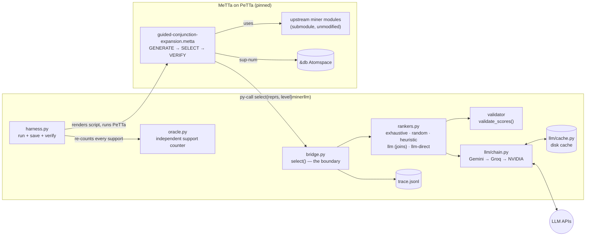
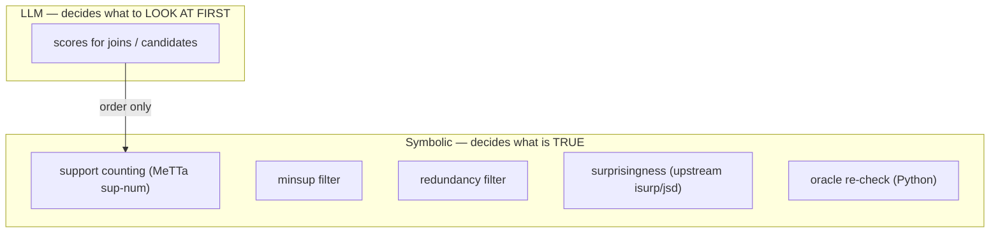
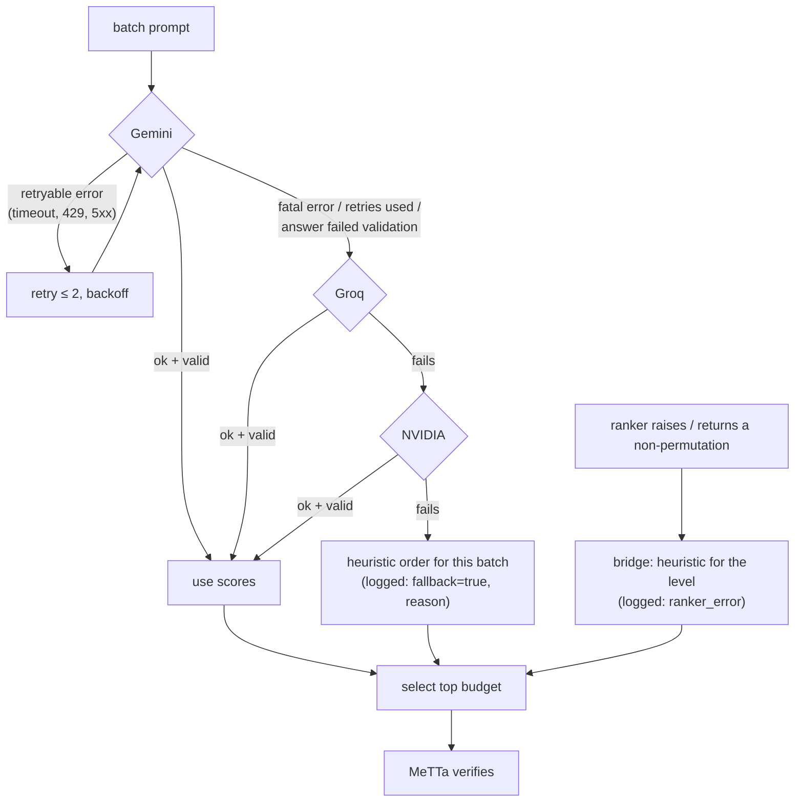

# Step 3 — Architecture

> *Show the components, interfaces, data flow, control flow, LLM boundary, validator and
> failure path.*

## 1. Components



| Component | File | Responsibility |
|---|---|---|
| Upstream miner | `external/hyperon-miner` (submodule, untouched) | candidate clauses, linkage, redundancy filter, support counting, `isurp`/`jsd` scoring |
| Guided expansion | `experiments/llm-guided-miner/guided-conjunction-expansion.metta` | splits each level into GENERATE → SELECT → VERIFY |
| Bridge | `minerllm/bridge.py` (+ `minerllm_bridge.py` shim) | the `py-call` API: dedupe, rank, apply budget, log |
| Rankers | `minerllm/rankers.py` | turn candidates into an *order* |
| Validator | `rankers.validate_scores` | decide whether an LLM answer may be used |
| LLM chain | `minerllm/llm/` | providers, retries, fallback, cache, mock |
| Harness + oracle | `minerllm/harness.py`, `minerllm/oracle.py` | run configs, re-check every support independently, save artefacts |

## 2. Control flow (one run)

```mermaid
sequenceDiagram
  autonumber
  participant H as harness (Python)
  participant M as guided miner (MeTTa)
  participant B as bridge.select
  participant R as ranker
  participant L as LLM chain
  H->>M: run script (fresh PeTTa process)
  M->>B: configure(run.json)
  M->>M: frequent single clauses (upstream candidate-pattern-miner)
  loop each level 0..depth
    M->>M: GENERATE all linked candidates (no counting)
    M->>B: select(candidate texts, level)
    B->>B: deduplicate (canonical form)
    B->>R: rank(unique candidates, schema stats)
    opt strategy llm (first level only)
      R->>L: score schema joins (≈3 calls)
      L-->>R: JSON scores
      R->>R: validate; invalid batch → heuristic
    end
    R-->>B: permutation of candidates
    B-->>M: positions of top ⌈budget × unique⌉
    M->>M: VERIFY: sup-num ≥ minsup, then redundancy filter
  end
  M->>M: score survivors with upstream isurp / jsd
  M->>B: finish()
  M-->>H: printed (supportOf …) / (surprisingnessOf …)
  H->>H: oracle re-counts every support; save JSON + trace
```

## 3. Data flow and interfaces

| Interface | Direction | Format |
|---|---|---|
| `(guided-pattern-miner out db initpat minsup depth surp norm ratio "run.json")` | caller → MeTTa | same 8 arguments as upstream `pattern-miner` + run-config path |
| `minerllm_bridge.configure(path)` | MeTTa → Python | JSON: `strategy, budget, seed, providers, batch_size, cache_dir, trace_path, dataset` |
| `minerllm_bridge.select(reprs, level) → [int]` | MeTTa ↔ Python | list of pattern **strings** in, list of **positions** out |
| `verify_started / verify_finished(level, kept)` | MeTTa → Python | timing + survivor count for the trace |
| LLM request | Python → API | schema description + numbered joins (or candidates); JSON mode; temperature 0 (Groq, NVIDIA) or low thinking level (Gemini 3.8 Flash) |
| LLM response | API → Python | `{"scores": [{"id": int, "score": 0-10}, …]}` |
| Trace | Python → disk | JSON lines: `configure`, `select` (sizes, batches, provider, tokens, issues), `verify`, `finish` |

**What the LLM sees:** relation names, arities, atom counts and distinct-value counts per
argument, and the joins/candidates to score. It **never sees individual facts**
(asserted in `tests/test_rankers.py`).

## 4. The LLM boundary



| The LLM **may** | The LLM **cannot** |
|---|---|
| give each join/candidate a 0–10 score | add a candidate (unknown ids are dropped) |
| thereby change the order of verification | change a support, a score or the minsup |
| | skip verification of what it ranks first |
| | see the data atoms |
| | stop the mining run |

Consequences, all tested:
1. **Budget 1.0 + exhaustive = upstream output**, exactly (`test-guided-equivalence.metta`, `test_exhaustive_guided_equals_upstream`).
2. **Any budget, any ranker:** output ⊆ exhaustive output, with identical supports, so precision stays 100 % (`test_budgeted_output_is_a_sound_subset`).
3. **Every printed support is re-counted** by the oracle in every harness run.

## 5. Validator

`validate_scores(text, valid_ids)` never trusts the model:

| Check | Action |
|---|---|
| not JSON (code fences are stripped first) | reject batch |
| no `scores` list | reject batch |
| entry without numeric `id`/`score` | drop entry |
| `id` not in this batch | drop entry ("the LLM cannot invent candidates") |
| duplicate `id` | keep first |
| score outside [0, 10] | clamp |
| < 50 % of ids scored | reject batch |

## 6. Failure path



Mining **never** stops because of the LLM. A total outage degrades to the heuristic
ranker, and the trace records every attempt (`test_total_llm_outage_still_completes`).

## 7. Design decisions

Recorded as ADRs in [docs/adr/](adr/):

| ADR | Decision |
|---|---|
| [0001](adr/0001-pin-petta.md) | Pin PeTTa; never track HEAD |
| [0002](adr/0002-generate-select-verify.md) | Split conjunction expansion into generate → select → verify, reusing upstream functions |
| [0003](adr/0003-llm-orders-never-decides.md) | The LLM only orders candidates; symbolic code decides truth |
| [0004](adr/0004-join-level-scoring.md) | Score schema joins, not candidates (cost) |
| [0005](adr/0005-dedupe-and-filter-order.md) | Deduplicate before counting; filter redundancy after counting |
| [0006](adr/0006-fallback-chain-cache-mock.md) | Gemini → Groq → NVIDIA chain, disk cache, offline mock |

→ Prototype details: [Step 4 — Prototype](04-prototype.md).
