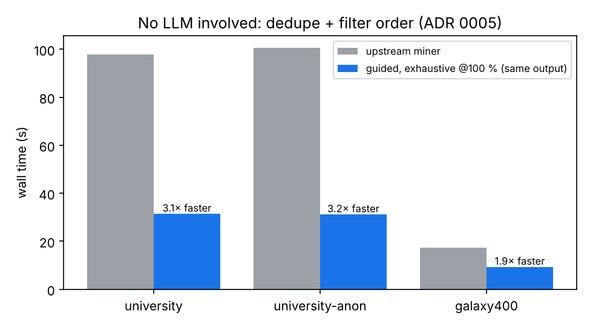

# Step 5 — Baseline

> *Compare against a baseline using the same tasks, data and miner configuration.*

## Same tasks, data, configuration

Every method runs from the same YAML config per dataset. Only the ranker and the budget
change:

| dataset | file | atoms | minsup | conjuncts | scorer |
|---|---|---:|---:|---:|---|
| university | `experiments/data/university_s0_st80.metta` | 504 | 10 | 3 | `isurp`, normalised, db-ratio 0.5 |
| university-anon | `experiments/data/university_s0_st80_anon.metta` | 504 | 10 | 3 | same |
| galaxy400 | `experiments/data/galaxy_400.metta` | 400 | 5 | 3 | same |

Each run is a fresh PeTTa process on the pinned PeTTa. Every printed support is re-counted
by the oracle (`results/runs.csv`, column `oracle_ok`).

## Baselines

| Baseline | What it answers |
|---|---|
| **upstream** (`external/hyperon-miner`, unmodified) | How long does iCog's miner take on this task today? |
| **exhaustive @ 100 %** (guided miner, every candidate verified) | Same output as upstream (proven), faster with no LLM (ADR 0005). This is the **reference** whose top-K patterns the budgeted methods must recover. |
| **random @ budget** (5 seeds) | What does verifying an *uninformed* fraction of the candidates give? Any useful ranker must beat this. |
| **structural heuristic @ budget** | A cheap structural rule: prefer joins across different relations, penalise dangling variables. **Degenerate** in practice: it picks rare joins that miss minsup, so it finds 0 patterns at 10–30 % on the university graph. Kept to show that "cheap rule" isn't automatically a good baseline. |
| **cardinality @ budget** | The strong cheap baseline: estimated support under independence, from the same schema statistics the LLM is shown (relation sizes, distinct values per argument). It verifies likely-frequent candidates first. **The LLM has to beat this** to be worth its cost (see the amendment in Step 2). |

Budgets: 10, 20, 30 and 50 % of the unique candidates at each level.

## Metric

**Tie-aware recall@K**: the fraction of the reference's top-K patterns (by `isurp`) that a
method also outputs. Patterns tied with the K-th score count as top-K, because upstream's
`isurp` has many ties ([evidence](evidence/synthetic-validation.md)). Precision is not
measured, because it's 100 % by construction (every output pattern is verified; the
`precision_ok` column checks that the output is a subset of the reference).

## Results

Generated by `make report` from `results/raw/`. Don't edit by hand.

<!-- BEGIN RESULTS-TABLES -->
### university

Exhaustive @ 100 %: 641 patterns, 13053 candidates verified, 31.4 s; upstream miner (same config): 97.9 s, 343 patterns scored.

| method | budget | recall@10 | recall@25 | planted | verified | time (s) | LLM (s) | tokens in/out | LLM fallbacks |
|---|---:|---:|---:|---:|---:|---:|---:|---:|---:|
| cardinality | 10 % | 50 % | 41 % | 0.0/3 | 582 | 6.9 | 0.0 | – | – |
| heuristic | 10 % | 0 % | 0 % | 0.0/3 | 111 | 1.7 | 0.0 | – | – |
| random | 10 % | 0 % ± 0 | 3 % | 0.0/3 | 245 | 2.8 | 0.0 | – | – |
| cardinality | 20 % | 58 % | 66 % | 0.0/3 | 1548 | 11.8 | 0.0 | – | – |
| heuristic | 20 % | 0 % | 0 % | 0.0/3 | 222 | 1.9 | 0.0 | – | – |
| random | 20 % | 7 % ± 8 | 8 % | 0.2/3 | 823 | 4.7 | 0.0 | – | – |
| cardinality | 30 % | 67 % | 76 % | 0.0/3 | 3037 | 19.6 | 0.0 | – | – |
| heuristic | 30 % | 0 % | 0 % | 0.0/3 | 782 | 2.4 | 0.0 | – | – |
| random | 30 % | 28 % ± 10 | 23 % | 1.2/3 | 1525 | 7.0 | 0.0 | – | – |
| cardinality | 50 % | 100 % | 100 % | 3.0/3 | 6527 | 31.9 | 0.0 | – | – |
| heuristic | 50 % | 0 % | 0 % | 0.0/3 | 2956 | 7.4 | 0.0 | – | – |
| random | 50 % | 43 % ± 14 | 39 % | 1.4/3 | 3793 | 12.8 | 0.0 | – | – |

### university-anon

Exhaustive @ 100 %: 641 patterns, 13053 candidates verified, 31.1 s; upstream miner (same config): 100.6 s, 343 patterns scored.

| method | budget | recall@10 | recall@25 | planted | verified | time (s) | LLM (s) | tokens in/out | LLM fallbacks |
|---|---:|---:|---:|---:|---:|---:|---:|---:|---:|
| cardinality | 10 % | 50 % | 41 % | 0.0/3 | 582 | 7.3 | 0.0 | – | – |
| heuristic | 10 % | 0 % | 0 % | 0.0/3 | 111 | 1.9 | 0.0 | – | – |
| random | 10 % | 7 % ± 10 | 4 % | 0.2/3 | 255 | 2.7 | 0.0 | – | – |
| cardinality | 20 % | 58 % | 66 % | 0.0/3 | 1615 | 12.9 | 0.0 | – | – |
| heuristic | 20 % | 0 % | 0 % | 0.0/3 | 222 | 2.0 | 0.0 | – | – |
| random | 20 % | 18 % ± 17 | 13 % | 0.2/3 | 847 | 4.9 | 0.0 | – | – |
| cardinality | 30 % | 67 % | 76 % | 0.0/3 | 3037 | 20.9 | 0.0 | – | – |
| heuristic | 30 % | 0 % | 0 % | 0.0/3 | 333 | 2.0 | 0.0 | – | – |
| random | 30 % | 22 % ± 11 | 23 % | 0.4/3 | 1703 | 7.8 | 0.0 | – | – |
| cardinality | 50 % | 100 % | 100 % | 3.0/3 | 6527 | 31.7 | 0.0 | – | – |
| heuristic | 50 % | 0 % | 0 % | 0.0/3 | 2956 | 7.4 | 0.0 | – | – |
| random | 50 % | 43 % ± 22 | 41 % | 1.4/3 | 3990 | 13.6 | 0.0 | – | – |

### galaxy400

Exhaustive @ 100 %: 115 patterns, 4267 candidates verified, 9.2 s; upstream miner (same config): 17.4 s, 109 patterns scored.

| method | budget | recall@10 | recall@25 | planted | verified | time (s) | LLM (s) | tokens in/out | LLM fallbacks |
|---|---:|---:|---:|---:|---:|---:|---:|---:|---:|
| cardinality | 10 % | 10 % | 16 % | – | 204 | 4.4 | 0.0 | – | – |
| heuristic | 10 % | 0 % | 0 % | – | 75 | 2.9 | 0.0 | – | – |
| random | 10 % | 2 % ± 4 | 2 % | – | 123 | 3.0 | 0.0 | – | – |
| cardinality | 20 % | 30 % | 24 % | – | 638 | 5.7 | 0.0 | – | – |
| heuristic | 20 % | 0 % | 0 % | – | 150 | 3.1 | 0.0 | – | – |
| random | 20 % | 16 % ± 8 | 12 % | – | 325 | 3.5 | 0.0 | – | – |
| cardinality | 30 % | 30 % | 36 % | – | 1106 | 6.5 | 0.0 | – | – |
| heuristic | 30 % | 0 % | 0 % | – | 225 | 2.4 | 0.0 | – | – |
| random | 30 % | 24 % ± 8 | 21 % | – | 576 | 3.7 | 0.0 | – | – |
| cardinality | 50 % | 70 % | 72 % | – | 2092 | 7.9 | 0.0 | – | – |
| heuristic | 50 % | 10 % | 8 % | – | 552 | 3.1 | 0.0 | – | – |
| random | 50 % | 36 % ± 10 | 38 % | – | 1301 | 4.8 | 0.0 | – | – |

<!-- END RESULTS-TABLES -->

→ Continued in [Step 6 — Results](06-results.md).
