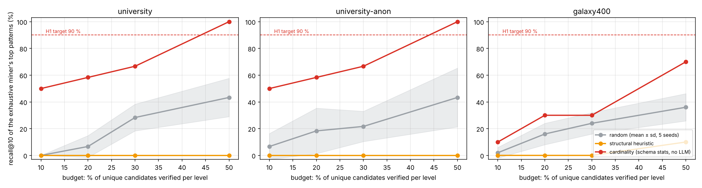
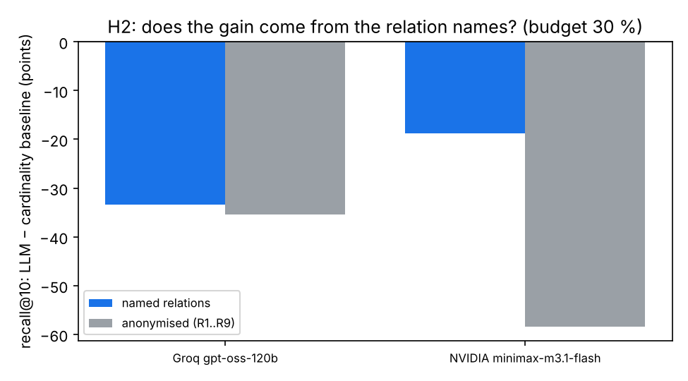

# Step 6 — Results

> *Report results, failures, cost and limitations, and state whether the evidence supports
> the hypothesis.*

## Verdict in one paragraph

**The evidence does not support the hypothesis.** At a 30 % verification budget, no LLM
ranker reached the 90 % recall@10 target on any dataset, and on average neither beat the
deterministic, LLM-free **cardinality** baseline: 67 % vs 33–48 % on the university graph
(H1 rejected). The LLM's occasional gains didn't come from the relation names (H2 not
supported): on the anonymised graph the useful joins Groq found were inferred from the
schema *statistics*. The LLM's rankings were also **unstable**: Groq gave 0–75 % recall on
identical input. What *did* hold, in all 135 runs, is the architecture's guarantee: every
output pattern was verified by MeTTa and re-counted by the oracle, **precision stayed at
100 %, and no LLM behaviour, however poor, produced a wrong result.** The solid
performance gain of this project is LLM-free: the same frequent patterns **3× faster** than
upstream, with every pattern scored (641 vs 343).

## Recall vs budget

## Verdicts (generated, criteria from Step 2)

<!-- BEGIN VERDICTS -->
**H1** (budget 30 %, recall@10):

| dataset / ranker | LLM | cardinality | structural | random (mean) | verdict |
|---|---:|---:|---:|---:|---|
| university / llm:groq | 33 % | 67 % | 0 % | 28 % | rejected: below 90 % |
| university / llm:nvidia | 48 % | 67 % | 0 % | 28 % | rejected: below 90 % |
| university-anon / llm:groq | 31 % | 67 % | 0 % | 22 % | rejected: below 90 % |
| university-anon / llm:nvidia | 8 % | 67 % | 0 % | 22 % | rejected: below 90 % |
| galaxy400 / llm:groq | 22 % | 30 % | 0 % | 24 % | rejected: below 90 % |
| galaxy400 / llm:nvidia | 42 % | 30 % | 0 % | 24 % | rejected: below 90 % |

**H2** (LLM − best cheap baseline, recall@10, budget 30 %):

| ranker | named | anonymised | verdict |
|---|---:|---:|---|
| llm:groq | -33 pts | -35 pts | not supported |
| llm:nvidia | -19 pts | -58 pts | not supported |
<!-- END VERDICTS -->

The LLM rows at 30 % are means over **4 independent LLM samples** (the evaluation run plus 3
repeats with the cache off, `make eval-llm` + `minerllm eval repeats`). Individual samples:

| dataset | Groq `gpt-oss-120b` recall@10 per sample | NVIDIA `minimax-m3.1-flash` recall@10 per sample | cardinality |
|---|---|---|---:|
| university | 67 · 50 · 17 · 0 % | 42 · 50 · 50 · 50 % | 67 % |
| university-anon | 75 · 0 · 50 · 0 % | 8 · 8 · 8 · 8 % | 67 % |
| galaxy400 | 20 · 0 · 60 · 10 % | 90 · 80 · 0 · 0 % | 30 % |

## What the traces show (why it didn't work)

Each run's trace logs the joins the LLM scored highest (`top_joins`), which makes the
LLM's reasoning inspectable:

| run | top-scored joins | reading |
|---|---|---|
| Groq, named | `ENROLLED_IN.arg2 = TEACHES.arg2` (course = course) ✓, `HELD_IN.arg2 = OFFERED_BY.arg1` (room = course) ✗ | sensible and type-mismatched joins mixed, all scored 9 |
| Groq, anonymised | `R3.arg1 = R5.arg1`, `R3.arg1 = R6.arg1`, `R3.arg1 = R8.arg1`, `R3.arg1 = R9.arg1` | all *student = student*: types inferred from the distinct-value counts, not from names |
| NVIDIA, anonymised | `R1.arg1 = R1.arg2` (score 9) | TEACHES' professor = course: a type error, repeated in all 4 samples, hence 8 % every time |

Three reasons stand out:

1. **The target rewards frequency.** Upstream's `isurp` scores are saturated
   ([evidence](evidence/synthetic-validation.md)): many generic, very frequent patterns tie
   near the top (e.g. `MAJORS_IN · MAJORS_IN · OFFERED_BY`, support 5,604). Cardinality
   verifies frequent candidates first, so it's well aligned with this target. An LLM that
   chases *meaningful* joins is not.
2. **Join scores replaced, rather than refined, the cardinality order.** The LLM score is
   the primary key and cardinality only breaks ties, so one wrongly high-scored join pushes
   whole families of infrequent candidates ahead of frequent ones.
3. **Sampling noise.** Temperature 0 didn't make hosted models deterministic. Groq's 4
   samples on the same prompt ranged from 0 to 75 %.

On the planted patterns, the result is mixed: Groq found **all 3** in 2 of its 4 anonymised
samples, and cardinality found **none** at 30 % (it ranks exactly the patterns that beat the
independence estimate low). The LLM *can* surface real dependencies that statistics miss.
It just doesn't do so reliably, and not in a way that improves top-10 recall.

## All numbers

<!-- BEGIN RESULTS-TABLES -->
### university

Exhaustive @ 100 %: 641 patterns, 13053 candidates verified, 31.4 s; upstream miner (same config): 97.9 s, 343 patterns scored.

| method | budget | recall@10 | recall@25 | planted | verified | time (s) | LLM (s) | tokens in/out | LLM fallbacks |
|---|---:|---:|---:|---:|---:|---:|---:|---:|---:|
| cardinality | 10 % | 50 % | 41 % | 0.0/3 | 582 | 6.9 | 0.0 | – | – |
| heuristic | 10 % | 0 % | 0 % | 0.0/3 | 111 | 1.7 | 0.0 | – | – |
| llm:groq | 10 % | 33 % | 21 % | 0.0/3 | 713 | 15.3 | 9.4 | 4282 / 6250 | 0/3 |
| llm:nvidia | 10 % | 8 % | 7 % | 0.0/3 | 658 | 44.4 | 39.0 | 4659 / 1551 | 0/3 |
| random | 10 % | 0 % ± 0 | 3 % | 0.0/3 | 245 | 2.8 | 0.0 | – | – |
| cardinality | 20 % | 58 % | 66 % | 0.0/3 | 1548 | 11.8 | 0.0 | – | – |
| heuristic | 20 % | 0 % | 0 % | 0.0/3 | 222 | 1.9 | 0.0 | – | – |
| llm:groq | 20 % | 67 % | 41 % | 1.0/3 | 1995 | 11.7 | 0.0 | 4282 / 6250 | 0/3 |
| llm:nvidia | 20 % | 25 % | 41 % | 0.0/3 | 2201 | 12.9 | 0.0 | 4659 / 1551 | 0/3 |
| random | 20 % | 7 % ± 8 | 8 % | 0.2/3 | 823 | 4.7 | 0.0 | – | – |
| cardinality | 30 % | 67 % | 76 % | 0.0/3 | 3037 | 19.6 | 0.0 | – | – |
| heuristic | 30 % | 0 % | 0 % | 0.0/3 | 782 | 2.4 | 0.0 | – | – |
| llm-direct:groq | 30 % | 67 % | 76 % | 0.0/3 | 2754 | 238.5 | 223.0 | 6346 / 6726 | 151/154 |
| llm:groq | 30 % | 33 % ± 26 | 30 % | 0.2/3 | 3246 | 31.0 | 16.9 | 4282 / 4602 | 0/3 |
| llm:nvidia | 30 % | 48 % ± 4 | 44 % | 0.0/3 | 3309 | 58.4 | 42.8 | 4659 / 1551 | 0/3 |
| random | 30 % | 28 % ± 10 | 23 % | 1.2/3 | 1525 | 7.0 | 0.0 | – | – |
| cardinality | 50 % | 100 % | 100 % | 3.0/3 | 6527 | 31.9 | 0.0 | – | – |
| heuristic | 50 % | 0 % | 0 % | 0.0/3 | 2956 | 7.4 | 0.0 | – | – |
| llm:groq | 50 % | 100 % | 90 % | 3.0/3 | 6378 | 23.8 | 0.0 | 4282 / 6250 | 0/3 |
| llm:nvidia | 50 % | 83 % | 83 % | 3.0/3 | 6288 | 23.3 | 0.0 | 4659 / 1551 | 0/3 |
| random | 50 % | 43 % ± 14 | 39 % | 1.4/3 | 3793 | 12.8 | 0.0 | – | – |

### university-anon

Exhaustive @ 100 %: 641 patterns, 13053 candidates verified, 31.1 s; upstream miner (same config): 100.6 s, 343 patterns scored.

| method | budget | recall@10 | recall@25 | planted | verified | time (s) | LLM (s) | tokens in/out | LLM fallbacks |
|---|---:|---:|---:|---:|---:|---:|---:|---:|---:|
| cardinality | 10 % | 50 % | 41 % | 0.0/3 | 582 | 7.3 | 0.0 | – | – |
| heuristic | 10 % | 0 % | 0 % | 0.0/3 | 111 | 1.9 | 0.0 | – | – |
| llm:groq | 10 % | 42 % | 34 % | 1.0/3 | 974 | 14.1 | 3.9 | 3954 / 7431 | 0/3 |
| llm:nvidia | 10 % | 0 % | 0 % | 0.0/3 | 551 | 100.7 | 95.5 | 4167 / 1551 | 0/3 |
| random | 10 % | 7 % ± 10 | 4 % | 0.2/3 | 255 | 2.7 | 0.0 | – | – |
| cardinality | 20 % | 58 % | 66 % | 0.0/3 | 1615 | 12.9 | 0.0 | – | – |
| heuristic | 20 % | 0 % | 0 % | 0.0/3 | 222 | 2.0 | 0.0 | – | – |
| llm:groq | 20 % | 42 % | 41 % | 1.0/3 | 1978 | 12.1 | 0.0 | 3954 / 7431 | 0/3 |
| llm:nvidia | 20 % | 8 % | 14 % | 0.0/3 | 2254 | 14.5 | 0.0 | 4167 / 1551 | 0/3 |
| random | 20 % | 18 % ± 17 | 13 % | 0.2/3 | 847 | 4.9 | 0.0 | – | – |
| cardinality | 30 % | 67 % | 76 % | 0.0/3 | 3037 | 20.9 | 0.0 | – | – |
| heuristic | 30 % | 0 % | 0 % | 0.0/3 | 333 | 2.0 | 0.0 | – | – |
| llm-direct:groq | 30 % | 67 % | 76 % | 0.0/3 | 3037 | 291.3 | 274.8 | 6045 / 6694 | 167/170 |
| llm:groq | 30 % | 31 % ± 32 | 41 % | 1.5/3 | 2970 | 31.7 | 18.8 | 3954 / 4097 | 0/3 |
| llm:nvidia | 30 % | 8 % ± 0 | 12 % | 0.0/3 | 3195 | 57.8 | 43.1 | 4167 / 1551 | 0/3 |
| random | 30 % | 22 % ± 11 | 23 % | 0.4/3 | 1703 | 7.8 | 0.0 | – | – |
| cardinality | 50 % | 100 % | 100 % | 3.0/3 | 6527 | 31.7 | 0.0 | – | – |
| heuristic | 50 % | 0 % | 0 % | 0.0/3 | 2956 | 7.4 | 0.0 | – | – |
| llm:groq | 50 % | 83 % | 93 % | 3.0/3 | 5662 | 19.2 | 0.0 | 3954 / 7431 | 0/3 |
| llm:nvidia | 50 % | 8 % | 14 % | 0.0/3 | 5861 | 20.4 | 0.0 | 4167 / 1551 | 0/3 |
| random | 50 % | 43 % ± 22 | 41 % | 1.4/3 | 3990 | 13.6 | 0.0 | – | – |

### galaxy400

Exhaustive @ 100 %: 115 patterns, 4267 candidates verified, 9.2 s; upstream miner (same config): 17.4 s, 109 patterns scored.

| method | budget | recall@10 | recall@25 | planted | verified | time (s) | LLM (s) | tokens in/out | LLM fallbacks |
|---|---:|---:|---:|---:|---:|---:|---:|---:|---:|
| cardinality | 10 % | 10 % | 16 % | – | 204 | 4.4 | 0.0 | – | – |
| heuristic | 10 % | 0 % | 0 % | – | 75 | 2.9 | 0.0 | – | – |
| llm:groq | 10 % | 0 % | 8 % | – | 197 | 9.6 | 6.5 | 3806 / 3756 | 0/3 |
| llm:nvidia | 10 % | 40 % | 24 % | – | 231 | 48.7 | 45.5 | 4241 / 1236 | 0/3 |
| random | 10 % | 2 % ± 4 | 2 % | – | 123 | 3.0 | 0.0 | – | – |
| cardinality | 20 % | 30 % | 24 % | – | 638 | 5.7 | 0.0 | – | – |
| heuristic | 20 % | 0 % | 0 % | – | 150 | 3.1 | 0.0 | – | – |
| llm:groq | 20 % | 20 % | 32 % | – | 605 | 4.5 | 0.0 | 3806 / 3756 | 0/3 |
| llm:nvidia | 20 % | 80 % | 60 % | – | 622 | 4.1 | 0.0 | 4241 / 1236 | 0/3 |
| random | 20 % | 16 % ± 8 | 12 % | – | 325 | 3.5 | 0.0 | – | – |
| cardinality | 30 % | 30 % | 36 % | – | 1106 | 6.5 | 0.0 | – | – |
| heuristic | 30 % | 0 % | 0 % | – | 225 | 2.4 | 0.0 | – | – |
| llm-direct:groq | 30 % | 30 % | 32 % | – | 1057 | 77.1 | 71.9 | 1695 / 2913 | 59/60 |
| llm:groq | 30 % | 22 % ± 23 | 27 % | – | 865 | 159.9 | 155.1 | 3432 / 2532 | 0/3 |
| llm:nvidia | 30 % | 42 % ± 43 | 35 % | – | 1045 | 34.1 | 29.4 | 4241 / 1236 | 0/3 |
| random | 30 % | 24 % ± 8 | 21 % | – | 576 | 3.7 | 0.0 | – | – |
| cardinality | 50 % | 70 % | 72 % | – | 2092 | 7.9 | 0.0 | – | – |
| heuristic | 50 % | 10 % | 8 % | – | 552 | 3.1 | 0.0 | – | – |
| llm:groq | 50 % | 100 % | 96 % | – | 2134 | 6.3 | 0.0 | 3806 / 3756 | 0/3 |
| llm:nvidia | 50 % | 100 % | 88 % | – | 2095 | 6.5 | 0.0 | 4241 / 1236 | 0/3 |
| random | 50 % | 36 % ± 10 | 38 % | – | 1301 | 4.8 | 0.0 | – | – |

<!-- END RESULTS-TABLES -->

## Cost

Join-level scoring costs the same at every budget and depth, because the scores are cached
per dataset:

| per dataset | Groq `gpt-oss-120b` | NVIDIA `minimax-m3.1-flash` |
|---|---:|---:|
| LLM calls | 3 | 3 |
| tokens in / out | 3.8–4.3k / 3.8–7.4k | 4.2–4.7k / 1.2–1.6k |
| LLM time, first run | 4–9 s (later samples up to 506 s when rate-limited) | 39–95 s |
| cost | **$0.003–0.005** | free developer credits |

For comparison, `llm-direct` (every candidate scored) needs **~150 calls per run**, about 50×
more. On Groq's on-demand tier (8,000 tokens per minute) it couldn't run at all: 151 of 154
batches were rate-limited and fell back, so its row is effectively the cardinality order.
That's why `llm-direct` quality was **not** evaluated (see Limitations).

Token prices: Gemini 3.8 Flash $0.75 / $3.75 per 1M (introductory, through 2026-12-31);
Groq `gpt-oss-120b` $0.15 / $0.60 per 1M; NVIDIA build.nvidia.com developer credits.

## Failures observed (all handled; mining never stopped)

| failure | when | how it was handled |
|---|---|---|
| Gemini 3.8 Flash overloaded: 180 s timeouts, then HTTP 503 "high demand" on every retry | smoke runs, 2026-11-14/15 | chain moved to Groq; provider order changed to Groq → NVIDIA → Gemini (ADR 0006) |
| Groq retired `llama-3.3-70b-versatile` (404) | first real run | switched to `openai/gpt-oss-120b` |
| NVIDIA retired `llama-3.3-70b-instruct` (410), then `mistral-large-2-instruct` (EOL 2026-11-15, the day before we used it) | first runs | `minerllm models --probe`: NVIDIA's list still includes retired models |
| Groq HTTP 429, 8,000 tokens per minute | first evaluation run: 2 of 3 batches per run fell back | honour "try again in Xs", sequential Groq batches, `reasoning_effort=low`; rerun: 0 fallbacks |
| Groq HTTP 400 "Failed to validate JSON" | occasional | retry once without JSON mode, validator still applies |
| A model answers in prose or with invented IDs | mock fault tests + occasional real answers | validator rejects or cleans; next provider; cardinality fallback |

Across **135 runs**: 0 oracle mismatches, 0 precision violations, 0 score mismatches.

## Limitations

* **Synthetic data dominates.** Two of three datasets come from one generator. Galaxy-400 is
  the only real graph, and it's small (400 atoms, 115 frequent patterns).
* **One depth.** Everything was measured at 3 conjuncts. The budget may matter more at 4,
  where upstream takes 90 s on 200 atoms.
* **Four LLM samples per cell at 30 %**, one sample at the other budgets. Enough to show the
  instability, not enough for tight confidence intervals.
* **Gemini was not evaluated** (overloaded throughout), and **`llm-direct` quality was not
  evaluated** (rate-limited on Groq; the NVIDIA run was optional and not done).
* **Wall-clock times come from two machines**: baselines on Linux, LLM arms on an M-series
  Mac. Candidate counts and recall are comparable; seconds are only indicative.
* **The target inherits upstream's scorer.** Recall is measured against `isurp`'s top-10,
  whose saturation favours frequent, generic patterns.
* One prompt design was tested. Different prompts (e.g. asking for type compatibility only)
  might behave very differently.

## What we would do next

1. **Use the LLM as a filter, not a ranker:** keep the cardinality order and let the LLM only
   *demote* joins it judges type-incompatible. The anonymised traces suggest type reasoning
   is where it helps.
2. **Self-consistency:** combine several LLM samples (median score per join) to remove the
   0–75 % swings.
3. Evaluate at **4 conjuncts** and on larger real graphs.
4. Send `patches/0001` and `patches/0002` upstream, and look at the scorer saturation.
